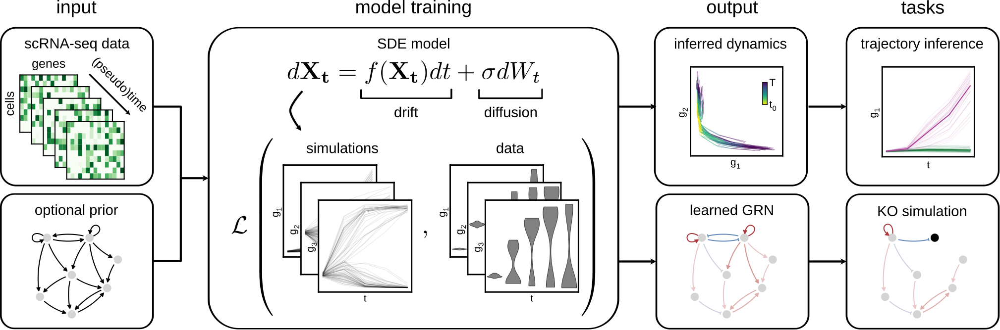

```{include} ../../README.md
:end-before: "# bowside"
```

# bowside documentation



```{include} ../../README.md
:start-after: "# bowside"
:end-before: "## Installation"
```


```{toctree}
:maxdepth: 2
:caption: Contents:
installation.md
api.rst
release_notes.md
```
